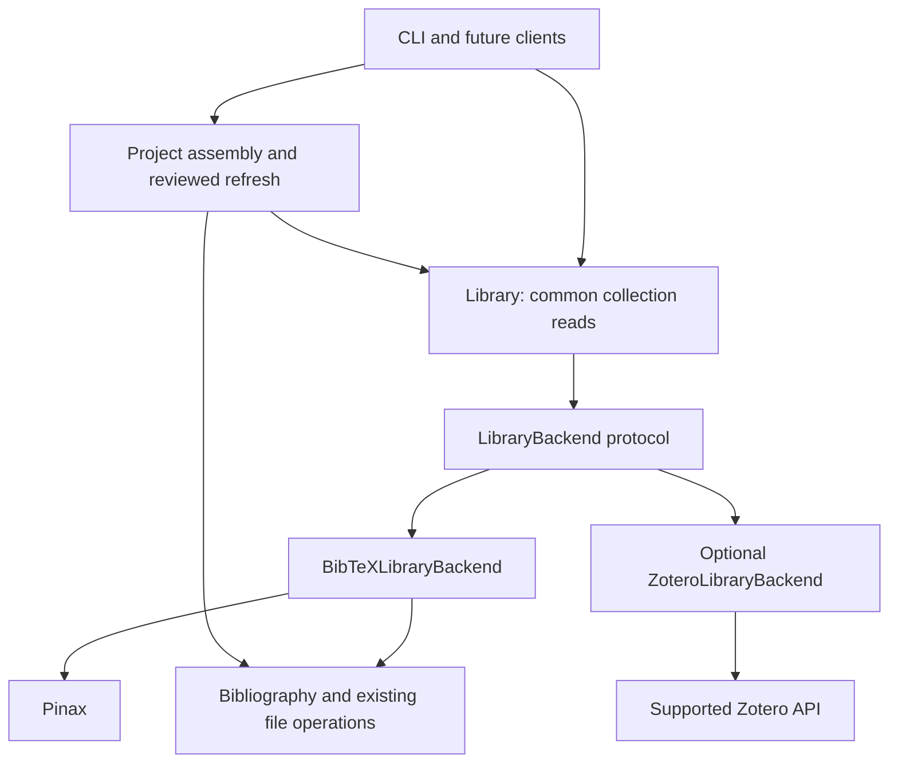

# Library backends: accepted design

Status: design accepted, 2026-11-04; implementation pending. The accepted scope
is a common Library read interface, backend-specific capabilities and authority,
and preservation of existing Bibliography contracts. Exact method signatures,
persisted schemas and the optional client dependency remain implementation
decisions. No backend abstraction or Zotero adapter is implemented by this
document. Zotero compatibility still depends on the experiment below and may be
dropped if it fails.

## Decision

A common Library interface is feasible for discovery, record reads, work
comparison, material discovery and selection into project bibliographies.
Mutation needs separate, capability-specific contracts. Treating Zotero as a
different filesystem, or converting its database into a temporary `.bib` before
every operation, would hide important differences and lose information.

Keep `Library` as the domain name. Introduce an internal `LibraryBackend`
protocol, with `BibTeXLibraryBackend` and, conditionally, `ZoteroLibraryBackend`.
The existing class is already the first implementation in substance. Start by
wrapping it, preserving `Library.open()` and `Library.from_files()`, rather than
renaming the public API or replacing `Bibliography`.

`LibraryService` remains the name for the later session/orchestration layer.
`LibraryManager` would suggest managing several connections; it is unnecessary
for the initial backend contract. `LibraryEngine` and
`BibliographyManagementSystem` do not clarify the collection/storage boundary.

The user chooses the authoritative backend. A Zotero-backed Library does not
require copying all its records or PDFs into our file-backed Library. A selected
project bibliography is an independent, explicitly maintained `.bib` destination.

## What the current engine allows and constrains

Code inspected at `4917e9a`:

| Current boundary | Implication for an abstraction |
| --- | --- |
| `library.py`: `LibraryHit` requires file, entry index, line and SHA-256; `LibraryRead` reports member paths | Add source-neutral reports alongside these types; do not invent file paths for Zotero |
| `Library.lookup()` returns every citation-key occurrence | Source record identity must be independent of citation keys and work identity |
| `_library_add.py`: staging returns a `Bibliography` and uses the private member list | Keep this as file-backend placement/staging; a Zotero writer cannot implement that return contract honestly |
| `model.py`: `BibEntry` includes raw text, field expressions and surgical-edit state | Preserve it as the BibTeX editing model; it is not a lossless universal record |
| `providers/records.py`: `ReferenceMetadata` normalizes into BibTeX/BibLaTeX conventions | Reuse it at acquisition/projection boundaries, not as native Zotero storage |
| `identity.py`: `WorkEvidence` and `compare_work_evidence()` are separate from source persistence | Reuse conservative work matching through explicit evidence adapters |
| `interchange/csl.py` and other codecs map only supported fields/types | Conversion is a projection with a loss report, not the common source of truth |
| `bounded.py`: cursors bind a request to a digest-like snapshot | Hash the entire scoped backend revision before reusing this mechanism |
| `entry_reader.py`, parts of `analysis.py`, and Pinax assume `Bibliography` | Separate reference-only views from file/Pinax diagnostics; do not claim all existing operations work unchanged |
| `biblinks.py` declares reciprocal file-path/key relationships | Keep its contract; source-to-project provenance needs a different reference mapping |
| Provider transport rejects private/loopback destinations | Local Zotero needs an explicitly scoped transport; do not weaken public provider URL validation |

Four disposable offline probes confirmed the coupling:

1. Three entries sharing a citation key, within and across two files, remain
   three Library occurrences. File/hash/index distinguishes them in that read.
2. A synthetic `mvbook` passed through our CSL export/import becomes `book`,
   loses an unknown field and translator, and retains only the year from a full
   date. This establishes limits of our current codec, not of CSL itself.
3. Passing long prefixed revision strings directly to the existing cursor
   helper can hide changes beyond its truncated snapshot prefix. Hashing the
   complete revision first detects the change; current callers use digests.
4. The provider URL validator refuses `127.0.0.1` without making a request.

These are observations of current code, not a prototype of a Zotero backend.
The initial inspection found no Zotero executable on PATH. A subsequent check
found the `org.zotero.Zotero` Flatpak at version 10.0.7 with shared networking,
but no running Zotero instance; a host request to the local API root was refused.
No library records or profile were accessed. Installation is now available for
the experiment, but API reliability remains unverified locally.

## Zotero evidence and limits

The documented API exposes items, child items, collections, tags and export
formats. Native quick search is not our field/Boolean/fuzzy query language, and
local and web query results can differ. Requests support explicit pagination;
always set limits, including locally. These provide enough read primitives for
an adapter, not automatic query equivalence.
[Read API](https://www.zotero.org/support/dev/web_api/v3/basics)

The local API reads the running application's database without requiring cloud
sync. Current documentation assigns local writes to Zotero 10+, with runtime
authorization and instance-scoped versions. Earlier local versions did not track
unsynced edits reliably. Local attachment endpoints can resolve files on disk.
Therefore a tested modern client is the candidate baseline for guarded reads;
older clients must not be advertised with equivalent freshness guarantees.
[Local API](https://www.zotero.org/support/dev/web_api/v3/local_api)

Version preconditions support optimistic concurrency. Batch writes can report
successful, unchanged and failed items in the same response, so HTTP success
does not prove whole-plan success.
[Versioning](https://www.zotero.org/support/dev/web_api/v3/syncing),
[write results](https://www.zotero.org/support/dev/web_api/v3/write_requests)

Collections are overlapping memberships: adding one item to two collections
does not create two records. They are not equivalents of two owning `.bib`
members. [Collections](https://www.zotero.org/support/collections_and_tags)

Attachments have their own records, link modes and file-transfer lifecycle.
Zotero annotations are separate from original PDF bytes. Material listing,
byte access and annotation transfer must be independent capabilities.
[Attachments](https://www.zotero.org/support/dev/web_api/v3/file_upload),
[annotations](https://www.zotero.org/support/kb/annotations_in_database)

There is concrete evidence of recent API defects and fixes: the official
changelog records fixes for client-supplied object keys in 10.0.5 and form-encoded
spaces in 10.0.6. The developer guidance also documents changed local version
semantics and request restrictions. This justifies a versioned conformance gate;
it does not establish that the current read API is unreliable.
[Release history](https://www.zotero.org/support/changelog),
[developer changes](https://www.zotero.org/support/dev/zotero_10_for_developers)

## Accepted layers

This expresses dependencies, not a requirement to implement all these classes
immediately. The future service holds Library views and coordinates work; it
does not become another persistent database. A Catalogue remains derived from
the selected source and its revisions. Supporting several libraries in one
search is later federation, not an initial mixed-backend manifest.

### Minimal read contract

The first protocol should contain only backend description, bounded enumeration
and retrieval by source reference. Collection and material reads are optional
extensions. Search is a Library operation over those reads, with backend
pushdown only where equivalent results are established.

| Proposed value or operation | Required meaning |
| --- | --- |
| `describe()` | Source identity, supported schema/API, capabilities, permissions and availability |
| `scan(request, cursor)` | Bounded item pages with an observed revision, coverage diagnostics and resumable position |
| `get(item_ref, expected_revision)` | One source occurrence; stale/missing/unsupported remains explicit |
| `ReferenceView` | Immutable common metadata projection, native type, optional citation key, identifiers, provenance and mapping diagnostics |
| `ItemRef` | Backend/source/record identity, with its stability scope declared |
| `Revision` | Opaque, source-scoped precondition; never assumed to be a SHA-256 or comparable across backends |
| `CollectionRef` | Named overlapping membership, distinct from an owning file member |
| `MaterialRef` | Source material identity, owner relationship, media type, availability and known hashes with algorithms |
| `ReadPage` | Items, next cursor, optional total, coverage, truncation, freshness and issues |

Method and record shapes are sketches, not exports. In particular:

- A source occurrence, a bibliographic work, a citation key and a PDF hash are
  four different identities. Never use a DOI or a citation key as a universal
  record primary key. Reuse work matching only as evidence for reconciliation.
- File occurrence references can initially be snapshot-scoped:
  member locator + source digest + entry index. Durable identity across arbitrary
  external reordering, key renames or duplicate edits is not implemented. Reject
  stale references; do not reconnect them by a silent fuzzy match. A future
  explicit ID/alias scheme needs its own persistence decision.
- Zotero identity includes the library and item key, with instance/transport
  context for revisions. An item version from the web, another local profile or
  a restored/replaced source cannot be used as a local precondition.
- Represent creators with roles and literal/person distinction; retain original
  date/title values alongside any interpreted forms. Keep identifiers as a
  multivalued set. Resolve BibTeX inheritance for reads while retaining origin
  information, without flattening the authoritative entry on disk.
- Preserve native records in the backend or a version-bound read cache. A common
  view need not include every native field, but must report unsupported mappings.
  Never round-trip edits through a reduced projection. Private native payloads,
  notes and attachment paths are opt-in read expansions, not default output.
- Keep bibliographic items, notes, annotations and standalone attachments
  distinguishable. Filter explicitly and report coverage; do not manufacture
  bibliographic records for every object returned by an API.

CSL-JSON is useful for citation export and `ReferenceMetadata` for BibTeX-ready
acquisition. Neither should replace native records. A BibTeX projection can feed
existing analysis routines where its losses are acceptable and reported;
file-specific lint, inheritance, provenance and material diagnostics stay scoped
to the corresponding backend. Do not rewrite every engine operation first.

### Search, refresh and capability negotiation

Expose `supported`, `available`, `permission-required` and `unsupported` states
with reasons. A boolean `writable` is insufficient: metadata updates, collection
membership and attachment bytes can have different permissions and guarantees.

For common search, evaluate our supported grammar over a bounded, explicitly
loaded projection. Push down a predicate only if it preserves all candidate
matches; otherwise scan or report an unsupported/incomplete query. Never replace
our query with Zotero quick search silently. Native saved searches can be a
separate capability, with explicitly native semantics.

Bind pagination to the source instance, observed revision, query, sort order and
mapping version. Detect changes while scanning and retry within a bounded budget
or return incomplete/stale results. Offset pagination alone is not a consistent
snapshot. Avoid exact total/global-rank claims until the relevant scan is complete.
Reopening or refreshing is explicit; cached absence must not prove deletion.

Compute a digest of the full revision namespace before passing it to existing
cursor helpers. If a server lacks a reliable change token, expose weaker reads
or reject the guarded operation; do not pretend a token is reliable because the
API supplies an integer.

### Writes and material access

Leave writes out of the minimal read protocol. Optional writers can later expose
`prepare(change_request)` and `apply(plan)` with typed capabilities and receipts.
Each plan identifies affected records, fields, native preconditions, supported
commit units and retry/recovery behavior. File writers use `Bibliography` and
surgical editing; Zotero writers use native, schema-validated field updates.
Field deletion must be explicit, not inferred from fields absent in a projection.

File-member placement remains a file-backend capability. Adding collection
memberships is a different operation. Unknown fields, unsupported types, missing
permissions and unknown commit outcomes must remain explicit. A timed-out write
requires reconciliation before retry; no common interface promises distributed
atomicity or unlimited idempotency across sources.

Pinax and Zotero remain alternative material owners. Reading a Zotero-backed
Library must not reorganize its attachments into Pinax. Listing a `MaterialRef`
does not fetch bytes; materialization is explicit and budgeted. A file path is
optional, and unavailable bytes differ from no attachment. Compute SHA-256 when
bytes are actually read; a backend's MD5 is not a SHA-256 substitute. Transfer
into a project or another backend uses a reviewed copy plan and separate
annotation handling.

## Client, configuration and persistence consequences

- Preserve all existing file-command envelopes and meanings. New source-aware
  reads need typed source references; do not place a Zotero URI into a `file`
  field documented as a filesystem path. Settle the additive envelope and
  capability/error catalogue before exposing commands.
- Retain version-1 `.library.toml` manifests unchanged. Initially use explicit
  Python backend construction for the experiment. A later connection descriptor
  can select a backend; member routing and formatting remain backend-specific.
  Credentials stay outside manifests and Git. Do not silently add a new
  project-level settings mechanism to fit a connection.
- Extend the current three-form settings convention deliberately: file behavior
  still uses CLI/API plus bibliography metadata. Zotero must not receive fake
  `pynakes-meta` comments. During the read-only experiment, connection selection,
  credentials and read budgets are explicit run mechanics; persistent backend
  policy needs a separate schema decision before shipping behavior options.
- Treat explicit loopback access as local IPC. Isolate its allowed origin,
  redirects, timeouts and response limits from the public provider transport.
  Do not follow arbitrary `file://` or external redirects as HTTP requests;
  resolve selected local attachments through the material boundary. Remote Zotero
  access is a separate, explicit network mode, never an automatic fallback.
- Scope the vision's file-authority guarantee to `Bibliography` and the file
  backend. The shared invariant becomes: the selected backend is authoritative;
  views and indexes are derived. This boundary is accepted in the vision; backend
  implementation remains pending.
  Source mappings, accepted refresh baselines and authored decisions cannot be
  discarded as caches. Their versioned, exportable storage remains to be designed.
- Keep `biblink` for reciprocal file relations. A source-to-project association
  instead records source item identity, target citation key, accepted source
  values, target values and mapping version. Refresh uses both baselines to
  distinguish upstream changes from project edits, with reviewed conflicts.

## Implementation experiment and stopping rules

This is a feasibility gate before committing to compatibility, not a promise to
support every Zotero version. The read experiment can happen before full managed
PDF ingestion: using Zotero as the Library requires no migration into Pinax.

1. **Wrap the existing backend.** Add internal read records/protocols while
   keeping current Library entry points and tests unchanged. Exercise duplicate
   keys, missing members, stale snapshots and source fidelity through both views.
2. **Use synthetic API fixtures.** Cover bibliographic and non-bibliographic
   items, creator roles, dates, unknown fields, collections, pagination, changed
   revisions and unavailable attachments. Validate projections and diagnostics.
3. **Test a disposable Zotero profile.** Start with a current stable release;
   record exact application and adapter versions. Enumerate more than one page;
   edit unsynced items, add/delete items during paging, restart, switch profiles,
   disable access and interrupt requests. Verify changed versions, stale cursors,
   missing-item diagnostics and retry behavior. Test supported operating systems
   before advertising them. Do not use a personal library for failure injection.
4. **Exercise the useful workflow.** Read/select through both backends, preview
   one project bibliography, accept it and refresh after source and target edits.
   Preserve independent project keys and unsupported-data reports. No source
   mutation, auto-sync, Catalogue or GUI is necessary for this proof.
5. **Evaluate optional writes separately.** Only after read acceptance, test
   version preconditions, native validation, authorization refusal/expiry,
   partial batches, ambiguous timeouts and application restart. Metadata and
   attachment writes earn support independently; no two-way sync is implied.

Evaluate the maintained [Pyzotero client](https://pyzotero.readthedocs.io/en/latest/)
before writing a transport: it documents local reads and writes. Audit pagination,
timeouts, retries, credential handling and source-version scope against our
contract. Keep it optional and inside the adapter; its classes and exceptions
must not become the engine's public data model. No dependency is selected yet.

**Proceed** only if supported public APIs meet the required behavior without
weakening source fidelity, conflict detection or explicit I/O. Measure scan cost,
response size and memory; agree practical budgets from those measurements.

**Restrict** support when a deficiency is isolated: read-only operation, a tested
version range, or explicit unsupported capabilities are acceptable if they still
provide the advertised workflow.

**Drop the live backend** if supported versions cannot reliably enumerate and
identify records, detect relevant changes, or expose required material access;
if operation requires direct database edits/private application APIs; or if
maintenance requires invasive exceptions throughout core. Ordinary import/export
can remain. Dropping compatibility must not block the native Library roadmap.

Current conclusion: a common read abstraction is well supported by the code and
documented API; live reliability and write compatibility still need the experiment.
Recent fixed defects warrant testing, not an unsupported verdict about Zotero
as a whole. A large generic management framework is not justified at this stage.
